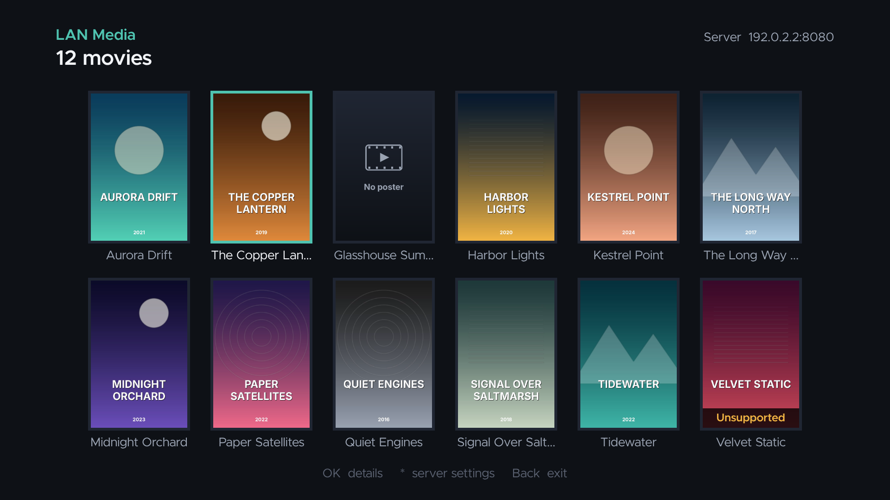

# Roku LAN Media Player

A private, sideloaded Roku SceneGraph app that browses a poster grid of movies
served by a manually started Windows 11 HTTP server on the same LAN. Direct play
only, no transcoding, no cloud dependency.

Version **0.1.0**, the first implementation of the
[v0.3 design handoff](docs/design/README.md).



More screenshots are in [`docs/screenshots/`](docs/screenshots/README.md).

## Repository layout

```
windows-server/   Python FastAPI + SQLite catalog, range-aware streaming (runs on the PC)
roku-client/      BrightScript / SceneGraph app (sideloaded onto the Roku)
tools/            Asset generators, sample-library generator, screenshot harness
docs/design/      Design handoff v0.3 (requirements, architecture, API, roadmap)
docs/screenshots/ UI screenshots captured from the real app in a Roku simulator
```

## 1. Run the server on Windows 11

1. Install **Python 3.10+** from python.org. Tick "Add python.exe to PATH".
2. Optional but recommended: install **FFmpeg** and put `ffprobe` on `PATH`. The
   server uses it only to *read* codecs and runtime; it never transcodes. Without
   it, every `.mp4`/`.m4v` is listed as "codecs not verified".
3. Edit `windows-server/config.json` and point `media_roots` at your movie folders:
   ```json
   "media_roots": [
     {"name": "Movies", "path": "D:\\Movies"},
     {"name": "Kids",   "path": "D:\\Kids Movies"}
   ]
   ```
4. Allow the port through Windows Firewall for your local subnet only. Run this
   once in an elevated PowerShell:
   `powershell -ExecutionPolicy Bypass -File windows-server\add_firewall_rule.ps1`.
   Never forward the port on your router.
5. Double-click `windows-server\start_server.bat`. The first run creates a
   `.venv` and installs the requirements. It then scans the folders and prints
   the address to type into the Roku:
   ```
   Catalog: 12 titles (11 direct-play ready)
   Enter one of these in the Roku app:
       Server IP: 192.168.1.50    Port: 8080
   ```

The server rescans on every start. To pick up new files, close the window and
start it again.

### Posters and titles

* Titles come from file names: `The.Long.Way.North.(2017).mp4` becomes
  *The Long Way North* (2017).
* Posters are sidecar images next to the video: `<name>.jpg`/`.png`,
  `<name>-poster.jpg`, or `poster.jpg`/`folder.jpg` when the folder holds a
  single movie. Missing posters show a placeholder.

### Direct-play profile

Titles are marked playable only when they match the conservative allowlist in
`config.json` (`mp4` container, `h264` video, `aac` audio by default). Anything
else appears with an **Unsupported** badge and the details page explains what to
convert. The app never pretends to play it.

## 2. Sideload the Roku app

1. Enable developer mode on the Roku: press Home ×3, Up ×2, Right, Left, Right,
   Left, Right on the remote, then follow the prompts and set a password.
2. Build the zip (needs Node 18+):
   ```
   cd roku-client
   npm ci
   npm run package        # -> roku-client/out/roku-lan-media.zip
   ```
   CI also uploads this zip as a build artifact on every push.
3. Browse to `http://<roku-ip>` and upload the zip in the Development Application
   Installer.
4. In the app, enter the server IP and port. They are saved on the Roku and used
   automatically next time.

### Remote controls

| Where | Key | Action |
|---|---|---|
| Library | OK | Open details |
| Library | `*` | Server settings (change IP/port, reconnect) |
| Details | OK on **Play** | Start playback |
| Playback | OK / arrows | Show controls: **-15s**, **Play/Pause**, **+15s**, **Audio** |
| Playback | Play/Pause | Pause or resume |
| Playback | Replay | Jump back 15 s (shortcut) |
| Playback | Up, then Left/Right, then OK | Scrub the timeline and jump |
| Playback | Rev / Fwd | Scrub the timeline (10, 30 or 60 s steps, depending on length) |
| Playback | Back | Hide controls, or exit to details |

Seeks are clamped to `[0, duration - 3 s]`. Rapid taps queue onto the pending
target, so three taps of +15 make one +45 s jump. A seek made while paused stays
paused.

## Requirement status (v0.1.0)

| ID | Requirement | Status |
|---|---|---|
| F-01 | Manual server IP/port, saved | Done (Roku registry) |
| F-02 | Connection status with retry/edit | Done |
| F-03 | Poster grid with placeholder | Done |
| F-04 | Details: title, runtime, poster, playable status | Done |
| F-05 | Direct play MP4 over HTTP | Done (byte ranges, 206/416) |
| F-06 | Play, pause, timeline seek, Back | Done (custom HUD) |
| F-07 / F-08 | +15 s / -15 s | Done |
| F-09 | Seek bounds | Done (unit tested) |
| F-10 | Seek toast and timeline | Done |
| F-11 | Unsupported-format handling | Done |
| F-12 | EQ settings | Shown as **not available**; no fake presets |
| F-13 | Real EQ DSP | Not started (feasibility gate) |
| F-14 | Manual catalog refresh | Restart the server for now |
| F-15 | Captions, resume, discovery, search | Later |

### Not yet verified on hardware

Everything here is built and tested off-device: server unit tests, BrightScript
lint and unit tests, and full UI runs in the
[brs-engine](https://github.com/lvcabral/brs-engine) Roku simulator. The design
roadmap still calls for checks on a real Roku:

* Seek landing accuracy and timing on the target model (keyframe snapping).
* Whether the TV remote has a Replay key, and how Rev/Fwd feel as timeline scrubbing.
* Playback from the Windows host over Wi-Fi with real movie files.

## Development

```
# Server tests (ffmpeg on PATH enables the ffprobe tests)
cd windows-server && pip install -r requirements-dev.txt && python -m pytest

# Roku: lint (BrighterScript), unit tests (brs-node simulator), package
cd roku-client && npm ci && npm run lint && npm test && npm run package

# Regenerate committed images (needs Pillow)
python tools/make_assets.py

# Create a 12-title demo library with posters (needs FFmpeg + Pillow)
python tools/make_sample_library.py D:\DemoMovies
```

The screenshot harness is described in
[`docs/screenshots/README.md`](docs/screenshots/README.md).
