# UI screenshots (v0.1.0)

These are captures of the **real Roku app** (the same sideload zip) running in the
[brs-engine](https://github.com/lvcabral/brs-engine) Roku simulator at 1920×1080.
The app was driven with remote-key presses against the **real Windows server code**
serving the 12-title demo library from `tools/make_sample_library.py`. They are not
mock-ups. They are also not photos of a TV: fonts are the simulator's stand-ins for
the Roku system font, and the keyboard dialog is the simulator's version.

| # | Screen | Shows |
|---|---|---|
| 01 | 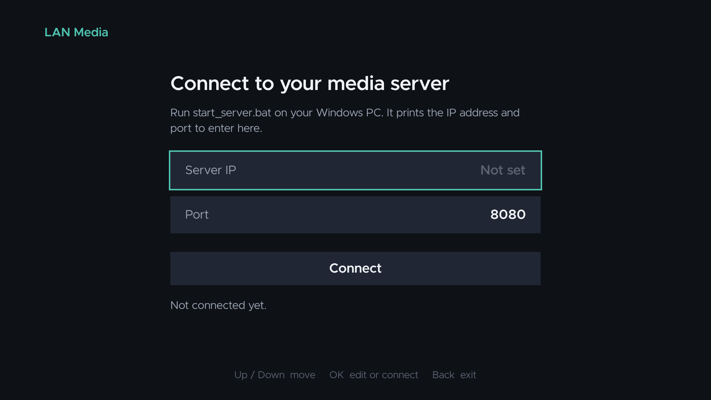 | First launch: manual server IP/port entry (F-01) |
| 02 | 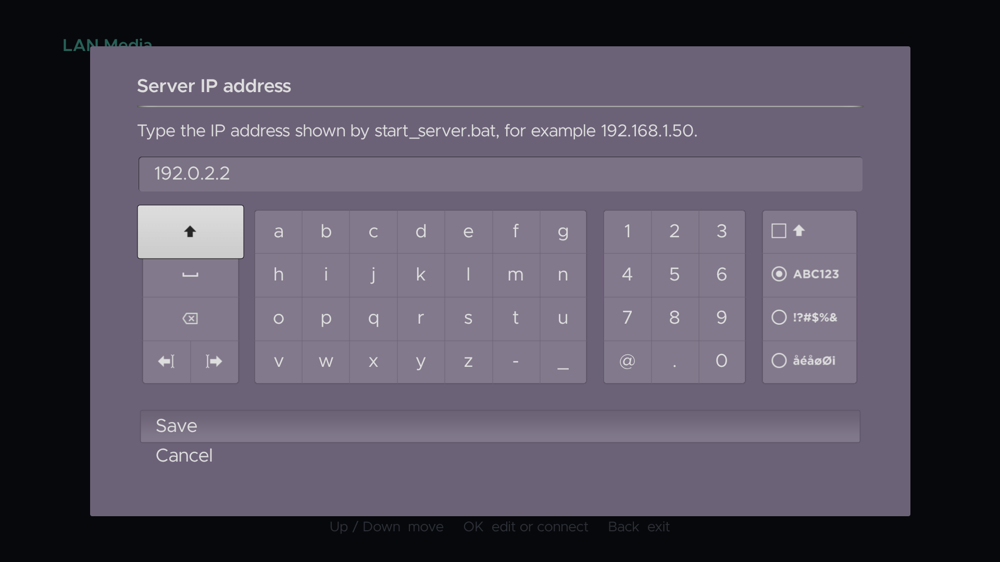 | Typing the IP printed by `start_server.bat` |
| 03 |  | Poster grid (F-03) with placeholder art (*Glasshouse Summer*) and an **Unsupported** badge (*Velvet Static*) |
| 04 | 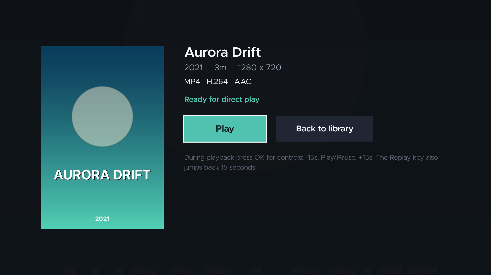 | Details: runtime, resolution, codecs, "Ready for direct play" (F-04) |
| 05 | 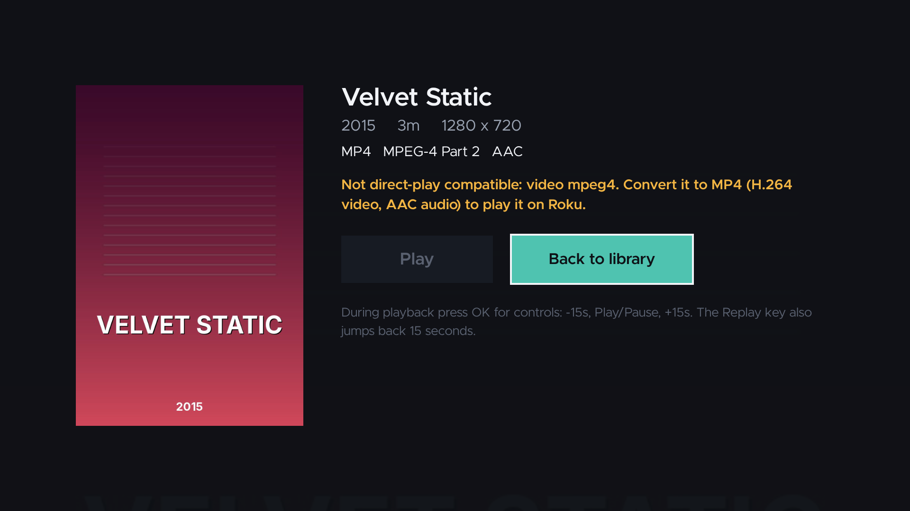 | MPEG-4 Part 2 title: explanation, Play disabled (F-11) |
| 06 | 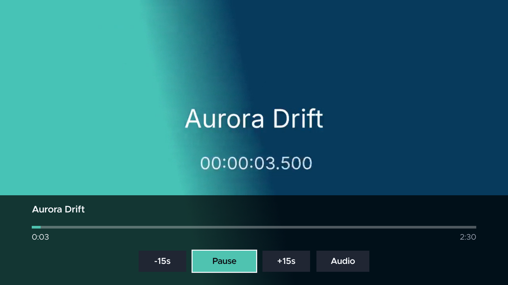 | Native Video playback over HTTP byte ranges, with the HUD shown at start |
| 07 | 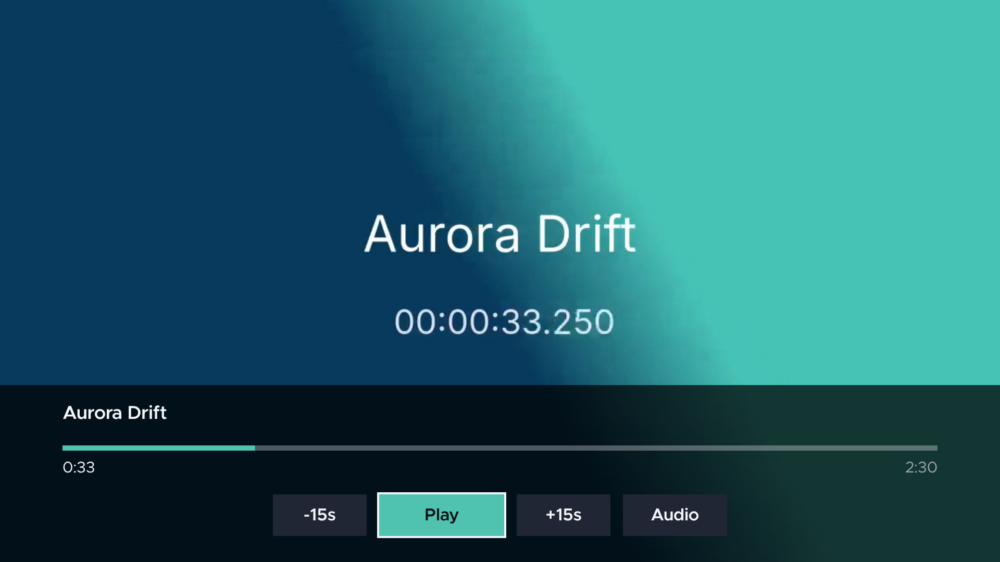 | Paused at 0:33: -15s / Play / +15s / Audio, plus the timeline (F-06) |
| 08 | 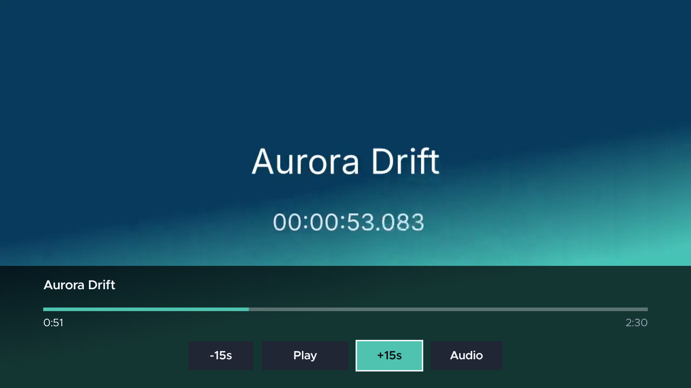 | After **+15s** (F-07) |
| 09 | 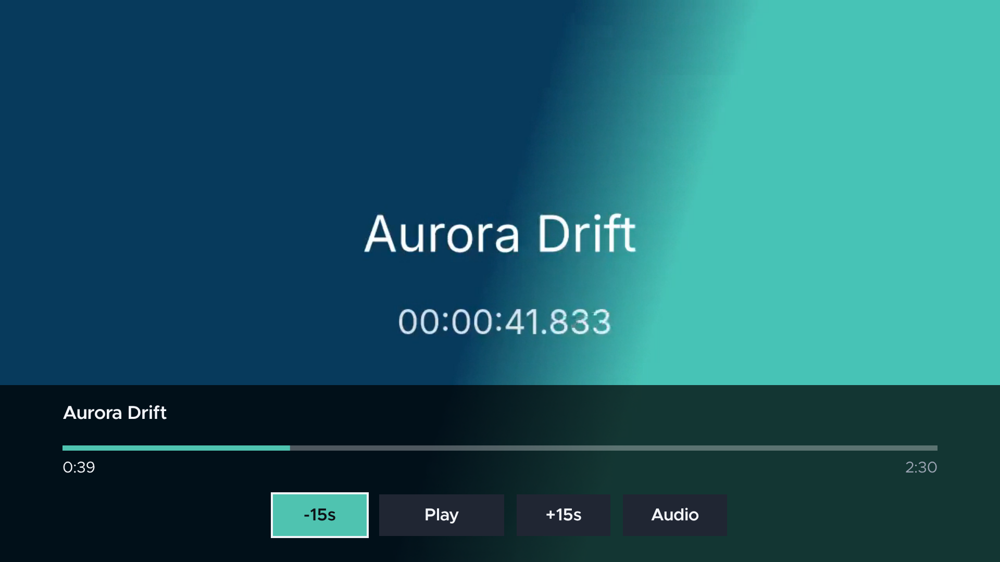 | After **-15s** (F-08) |
| 10 | 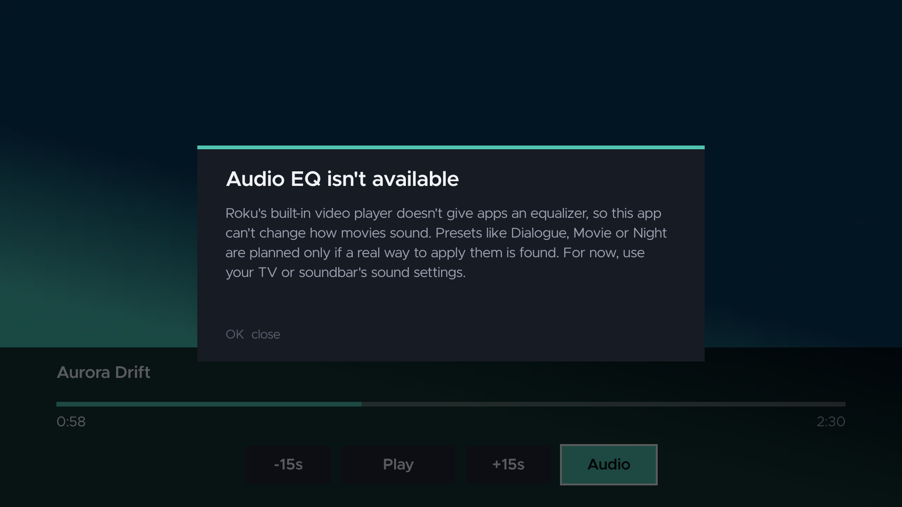 | Audio: EQ is honestly marked unavailable (F-12) |
| 11 | 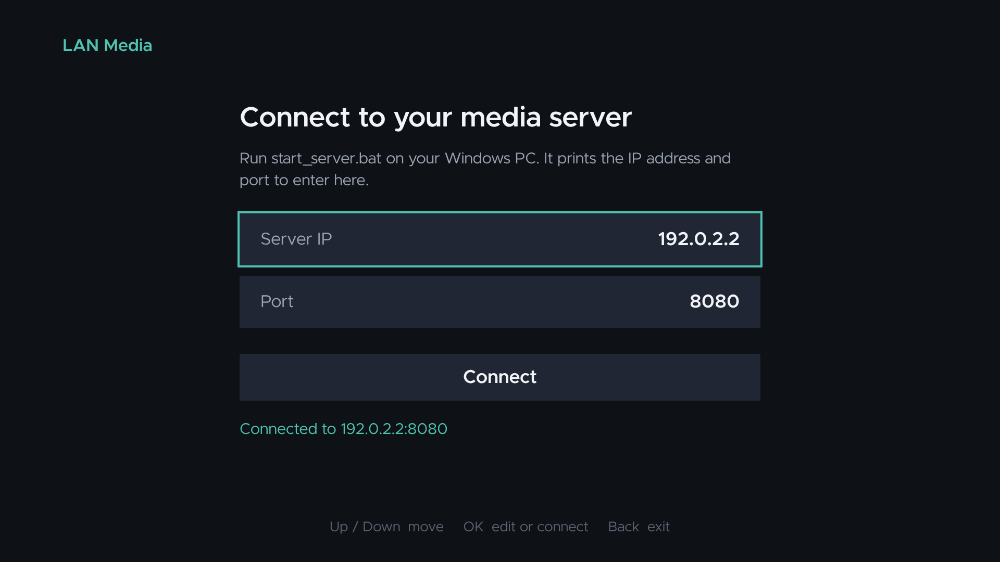 | `*` from the library: server settings, connected |
| 12 | 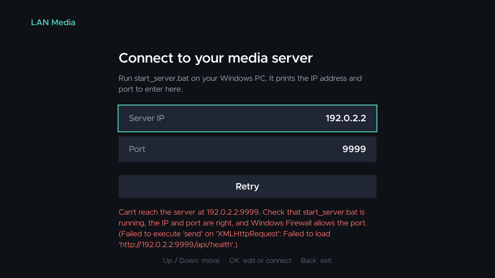 | Server unreachable: actionable error with Retry (F-02) |

Simulator caveats:

* In the simulator, the player keeps running for a moment after a seek made while
  paused. So 08 reads 0:51 rather than 0:48 (0:33 + 15 plus about 3 s of drift),
  and 09 is 15 s back from that. On a Roku the app keeps playback paused after
  such a seek; this still needs checking on hardware.
* Headless Chromium has no H.264 decoder, so the harness serves a WebM copy of the
  same clip for the video frames only. The app, its requests and the server are unchanged.
* The seek toast ("+15s", "to 0:48") renders in the CLI simulator but not over
  video in the browser build, so it doesn't appear in these frames.
* The error detail in 12 is the browser's network message. On a Roku it is the
  `roUrlTransfer` failure reason.

## Regenerating

```
# 1. Demo library and server (port 8090)
python tools/make_sample_library.py /tmp/library
#    point a config.json media root at /tmp/library, set "port": 8090
cd windows-server && python -m app --config /path/to/config.json

# 2. WebM copy for the browser's video element
ffmpeg -i "/tmp/library/Aurora Drift (2021).mp4" -c:v libvpx -b:v 1500k -c:a libvorbis /tmp/aurora.webm

# 3. Simulator harness on port 8080 (proxies /api to the server)
cd roku-client && npm ci && npm run package
cd ../tools/screenshots && npm install && npm run setup
APP_ZIP=../../roku-client/out/roku-lan-media.zip WEBM_MAP=<aurora media id>=/tmp/aurora.webm \
    uvicorn harness:app --host 0.0.0.0 --port 8080

# 4. Capture (Playwright + Chromium)
python capture.py http://<this machine's LAN IP>:8080 <same IP> ../../docs/screenshots
```
